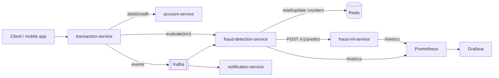
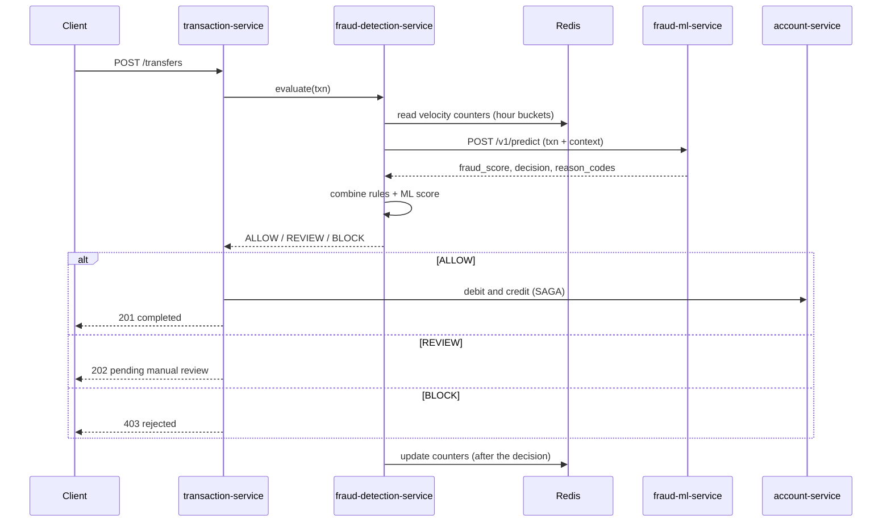

# 01. Architecture

> Status: draft. Everything involving services other than `fraud-ml-service` is a proposal to be confirmed when those services are designed.

## 1. System context

## 2. A transfer, end to end

Counters are updated **after** scoring so that the features for a transaction never include the transaction itself.

## 3. The ML service boundary

`fraud-ml-service` is deliberately small and boring:

| It does | It does not |
|---|---|
| Validate the request against the contract | Read or write Redis, Kafka, or any database |
| Turn the request into model features | Compute velocity history (the caller supplies it in `context`) |
| Score with the active model version | Decide to block money movement (it returns a recommendation) |
| Return score, decision, reason codes, model version | Know anything about accounts, SAGA, or notifications |
| Expose health, model info, and metrics | Call other services |

Why stateless: it keeps the ML service trivially scalable and testable, and it puts history (which depends on Redis) next to the service that owns Redis. The price is that both sides must compute features identically. See `fraud-ml-service/docs/02-feature-spec.md` and ADR-0006.

## 4. Decisions and where they live

| Decision | Owner |
|---|---|
| Maintaining velocity counters | `fraud-detection-service` |
| Business rules (limits, blocklists) | `fraud-detection-service` |
| ML score and recommended decision | `fraud-ml-service` |
| Final decision | `fraud-detection-service` |
| Moving money | `transaction-service` + `account-service` |

## 5. Failure handling (proposed)

| Failure | Behaviour |
|---|---|
| ML service slow (timeout, proposed 150 ms) | Fall back to rules-only decision; mark decision `scored_by=RULES` |
| ML service down | Circuit breaker opens; rules-only; alert fires |
| ML returns `scored_by_model=false` (unsupported type) | Rules-only for that transaction |
| Redis unavailable | Features unknown: route to REVIEW for amounts above a configured limit, else rules-only |
| Duplicate request | Safe: scoring is idempotent for the same `txn_id` |

## 6. Messaging (proposed Kafka topics)

| Topic | Producer | Consumers |
|---|---|---|
| `txn.initiated` | transaction-service | fraud-detection-service |
| `fraud.decisions` | fraud-detection-service | transaction-service, notification-service |
| `txn.completed` | transaction-service | notification-service |
| `fraud.feedback` | review tooling (later) | training pipeline (later) |

## 7. Non-functional targets (to validate, not guarantees)

| Metric | Target for `/v1/predict` |
|---|---|
| p95 latency (single instance, laptop-class container) | under 50 ms |
| p99 latency | under 100 ms |
| Cold start to ready | under 20 s |
| Error rate under normal load | under 0.1% |

These are design targets. They are checked in the testing strategy and may be revised with evidence.

## 8. Related documents

- Contract: `contracts/README.md`
- ML service API: `fraud-ml-service/docs/04-api-spec.md`
- Integration rules for callers: `fraud-ml-service/docs/10-integration-guide.md`
- Decisions: `docs/adr/`
