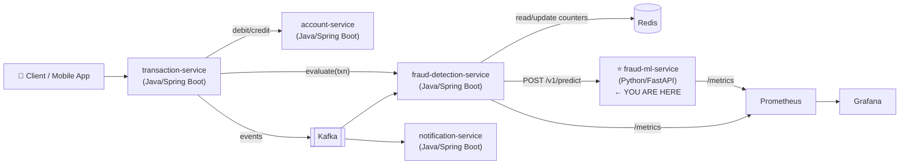
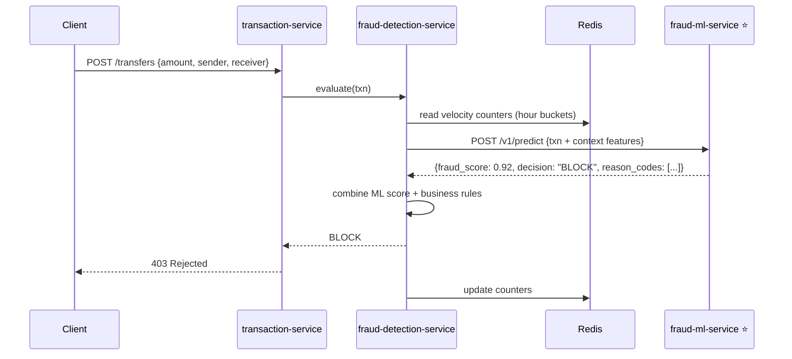
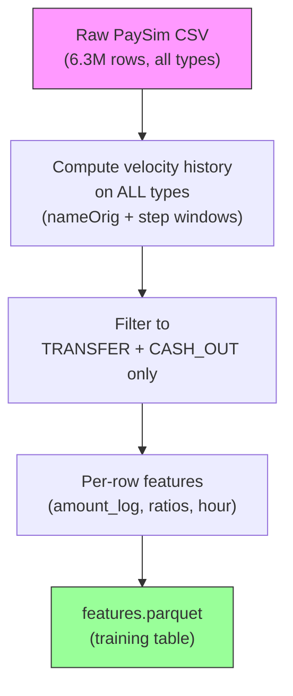
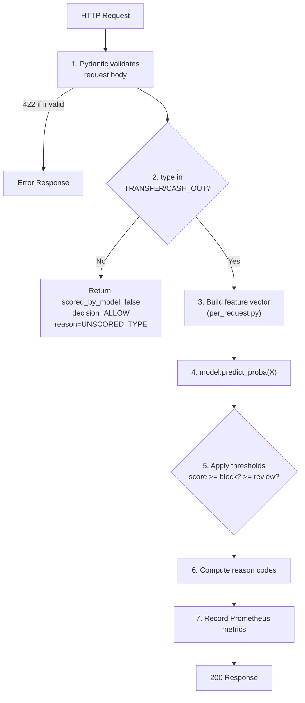

# 🏦 Digital Banking Fraud — ML Microservice: Complete Build Guide

> This is your working reference. Keep it open while you build. Each section maps directly to a Phase from the roadmap.

---

## 🗺️ Big Picture: What You're Building

### The Full System (All 5 Services)



> [!IMPORTANT]
> Right now you only need to build `fraud-ml-service`. The Java services (Phases 7–12) come later. The ML service is intentionally **stateless** — it receives all context from the caller, which makes it easy to test and scale independently.

---

### How a Transaction Flows (End to End)



**Your ML service's job is the single arrow** `F → M → F`: receive a request, run the model, return a score. Nothing more.

---

### What `fraud-ml-service` Does vs. Does NOT Do

| ✅ It DOES | ❌ It Does NOT |
|---|---|
| Validate the request (JSON Schema + Pydantic) | Read Redis, Kafka, or any DB |
| Compute per-request features (log, ratios) | Compute velocity history (caller sends it in `context`) |
| Score with the loaded model | Decide to block money movement |
| Return score + decision + reason codes + model version | Call other services |
| Expose `/metrics`, `/health/live`, `/health/ready` | Train models at request time |

---

## 📁 Project Layout (What Exists Now)

```
digital-banking-fraud/
├── contracts/                  ← JSON Schema contract between services (READ THIS FIRST)
│   ├── predict-request.schema.json
│   ├── predict-response.schema.json
│   └── README.md
├── docs/                       ← Project-wide docs
│   ├── 00-project-overview.md
│   ├── 01-architecture.md
│   └── 02-roadmap.md
├── fraud-ml-service/           ← YOUR FOCUS
│   ├── app/                    ← The running FastAPI service (to create in Phase 4)
│   │   ├── api/                ← HTTP routers
│   │   ├── core/               ← config, logging, metrics
│   │   ├── features/           ← feature code shared by training & serving
│   │   ├── model/              ← model loader, predictor, thresholds, reason codes
│   │   └── schemas/            ← Pydantic models
│   ├── training/               ← Offline pipeline scripts (to create in Phases 2–3)
│   ├── notebooks/              ← EDA (to create in Phase 1)
│   ├── artifacts/models/       ← Trained model files (git-ignored)
│   ├── data/raw/               ← PaySim CSV (git-ignored)
│   ├── data/processed/         ← Parquet files (git-ignored)
│   ├── config/
│   │   ├── training.yaml       ← All training settings (seeds, split, features)
│   │   └── thresholds.yaml     ← BLOCK/REVIEW thresholds
│   ├── docs/                   ← ML service docs (01 through 10)
│   ├── requirements.txt        ← Runtime deps
│   ├── requirements-train.txt  ← Training deps (kaggle, matplotlib, jupyter)
│   └── Makefile
└── infra/
    ├── docker-compose.yml
    └── prometheus/prometheus.yml
```

---

## 🔄 Phases Overview

| Phase | What | Your Role | My Role |
|---|---|---|---|
| **0** | Setup environment | Install tools, get dataset | Tell you exactly what to run |
| **1** | EDA + contracts | Write the EDA notebook | Guide what to look for, what decisions to make |
| **2** | Feature pipeline | Write `build_features.py` | Give you the complete script with explanations |
| **3** | Train models | Run training | Give you the complete `train.py` script |
| **4** | FastAPI service | Write the service code | Give you all files in `app/` |
| **5** | Docker + observability | Build container, set up Grafana | Guide Dockerfile and compose config |
| **6** | Hand-off | Write changelog, verify integration guide | Review checklist together |

---

## ⚡ Phase 0: Environment Setup

### Step 1 — Python Virtual Environment

```bash
cd /home/swayam/Workspace/Java/Projects/aiml/digital-banking-fraud-starter-kit/digital-banking-fraud/fraud-ml-service

python3.11 -m venv .venv
source .venv/bin/activate

python -m pip install --upgrade pip
pip install -r requirements.txt -r requirements-dev.txt -r requirements-train.txt

# Lock the versions
pip freeze > requirements.lock
```

### Step 2 — Verify Toolchain

```bash
# All of these must work without errors:
ruff check .
pytest                         # zero tests is fine, must not crash
python -c "import fastapi, sklearn, lightgbm, pandas; print('✅ imports ok')"
```

### Step 3 — Get the Dataset (PaySim from Kaggle)

**Where to get it:** [https://www.kaggle.com/datasets/ealaxi/paysim1](https://www.kaggle.com/datasets/ealaxi/paysim1)

**Option A — Kaggle CLI (recommended):**
1. Go to your Kaggle account → Settings → API → "Create New Token" → downloads `kaggle.json`
2. Place it at `~/.kaggle/kaggle.json`
3. Run: `chmod 600 ~/.kaggle/kaggle.json`
4. Download:
```bash
kaggle datasets download -d ealaxi/paysim1 -p data/raw --unzip
ls data/raw   # Should show: PS_20174392719_1491204439457_log.csv (~500MB)
```

**Option B — Manual download:**
1. Visit the Kaggle link above → Download → unzip
2. Place the CSV in `fraud-ml-service/data/raw/`

> [!NOTE]
> The CSV is ~500MB with ~6.3 million rows and 11 columns. It is **synthetic** (PaySim simulator) — it models mobile money transfers with injected fraud patterns. It's perfect for your learning project.

### Step 4 — Copy Environment File

```bash
cp .env.example .env
```

---

## 📊 Phase 1: Understanding the Data (EDA)

### What PaySim Looks Like

The CSV has these columns (after you download and peek):

| Column | What it is | Used? |
|---|---|---|
| `step` | Hour number (1–744, one month) | ✅ Time axis |
| `type` | CASH_IN, CASH_OUT, DEBIT, PAYMENT, **TRANSFER** | ✅ Filter & feature |
| `amount` | Transaction amount | ✅ Core feature |
| `nameOrig` | Sender account ID | ✅ For history features |
| `oldbalanceOrg` | Sender balance before | ❌ Excluded (ADR-0005) |
| `newbalanceOrig` | Sender balance after | ❌ Excluded |
| `nameDest` | Receiver account ID | ✅ For history features |
| `oldbalanceDest` | Receiver balance before | ❌ Excluded |
| `newbalanceDest` | Receiver balance after | ❌ Excluded |
| `isFraud` | **Label** | ✅ Target variable |
| `isFlaggedFraud` | Simulator's own rule flag | ❌ Excluded |

> [!IMPORTANT]
> Balance columns are excluded on purpose — they contain information that wouldn't be available to a real fraud model in the same way, and the PaySim authors flagged this as a leakage risk. See `docs/adr/0005-exclude-balance-columns.md`.

### Create Your EDA Notebook: `notebooks/01_eda.ipynb`

Here's the code to write in your notebook, cell by cell:

**Cell 1 — Load the data efficiently:**
```python
import pandas as pd
import numpy as np
import matplotlib.pyplot as plt

# Efficient loading with correct dtypes (avoids OOM on 6M rows)
dtypes = {
    'step': 'int16',
    'type': 'category',
    'amount': 'float32',
    'nameOrig': 'str',
    'oldbalanceOrg': 'float32',
    'newbalanceOrig': 'float32',
    'nameDest': 'str',
    'oldbalanceDest': 'float32',
    'newbalanceDest': 'float32',
    'isFraud': 'int8',
    'isFlaggedFraud': 'int8',
}

df = pd.read_csv('../data/raw/PS_20174392719_1491204439457_log.csv', dtype=dtypes)
print(f"Shape: {df.shape}")
print(f"Columns: {df.columns.tolist()}")
df.head()
```

**Cell 2 — Class balance:**
```python
total = len(df)
fraud = df['isFraud'].sum()
print(f"Total transactions: {total:,}")
print(f"Fraud: {fraud:,} ({fraud/total*100:.3f}%)")
print(f"Non-fraud: {total-fraud:,}")

# Fraud by type
print("\nFraud by type:")
print(df.groupby('type')['isFraud'].agg(['count', 'sum', 'mean'])
      .rename(columns={'mean': 'fraud_rate'})
      .sort_values('sum', ascending=False))
```

**Cell 3 — Check time split fraud counts (CRITICAL):**
```python
# These must each have >= 500 fraud cases
train = df[df['step'] <= 500]
val = df[(df['step'] >= 501) & (df['step'] <= 620)]
test = df[df['step'] >= 621]

for name, split in [('Train', train), ('Val', val), ('Test', test)]:
    fraud_count = split['isFraud'].sum()
    status = "✅" if fraud_count >= 500 else "❌ TOO FEW"
    print(f"{name}: {len(split):,} rows, {fraud_count} fraud cases {status}")
```

**Cell 4 — Amount distribution:**
```python
# Focus on the scored types only
scored = df[df['type'].isin(['TRANSFER', 'CASH_OUT'])]
fraud_amounts = scored[scored['isFraud'] == 1]['amount']
legit_amounts = scored[scored['isFraud'] == 0]['amount']

fig, axes = plt.subplots(1, 2, figsize=(14, 4))
axes[0].hist(np.log1p(fraud_amounts), bins=50, alpha=0.7, label='Fraud', color='red')
axes[0].hist(np.log1p(legit_amounts.sample(min(len(fraud_amounts)*5, len(legit_amounts)))), 
             bins=50, alpha=0.5, label='Legit', color='blue')
axes[0].set_title('log1p(amount) distribution')
axes[0].legend()

axes[1].hist(fraud_amounts, bins=50, alpha=0.7, color='red')
axes[1].set_title('Fraud amount distribution (raw)')
plt.tight_layout()
plt.savefig('../reports/figures/amount_dist.png', dpi=100)
plt.show()

print(f"\nFraud amount stats:\n{fraud_amounts.describe()}")
print(f"\n99th percentile of scored fraud-eligible transactions: {scored['amount'].quantile(0.99):.2f}")
```

**Cell 5 — Fraud over time (check for spikes):**
```python
fraud_by_step = df[df['isFraud'] == 1].groupby('step').size()
plt.figure(figsize=(14, 4))
fraud_by_step.plot()
plt.axvline(x=500, color='orange', linestyle='--', label='Train/Val boundary')
plt.axvline(x=620, color='red', linestyle='--', label='Val/Test boundary')
plt.title('Fraud cases per hour (step)')
plt.xlabel('Step (hour)')
plt.ylabel('Fraud count')
plt.legend()
plt.savefig('../reports/figures/fraud_over_time.png', dpi=100)
plt.show()
```

**Questions to answer at the top of your notebook after running:**
1. ✅/❌ Fraud occurs only in TRANSFER and CASH_OUT?
2. ✅/❌ Each split has ≥ 500 fraud cases?
3. What is the fraud amount 99th percentile? (save it — needed for reason codes)
4. Any unusual spikes in fraud over time?
5. PaySim go/no-go decision?

---

## 🔧 Phase 2: Feature Pipeline

### Concept: Why We Need Features

The model doesn't learn from raw transaction rows alone. It needs **context** — history about the sender and receiver. For example:
- Has this sender made 10 transactions in the last hour? (suspicious)
- Is this the first time this sender has ever paid this receiver? (risky)
- Is there a "fan-in" pattern — many senders paying one receiver? (money mule)

### The Feature Architecture



> [!IMPORTANT]
> History must be computed on ALL rows BEFORE filtering. A PAYMENT by sender A still counts toward A's velocity when scoring A's next TRANSFER.

### Script 1: `training/prepare_data.py`

Create this file:

```python
"""
Step 1: Load PaySim CSV, apply dtypes, add event order index, save as Parquet.
Run from fraud-ml-service/: python training/prepare_data.py
"""
import yaml
import pandas as pd
from pathlib import Path

# Load config
config_path = Path(__file__).parent.parent / "config" / "training.yaml"
with open(config_path) as f:
    cfg = yaml.safe_load(f)

raw_path = Path(cfg["dataset"]["raw_path"])
out_dir = Path(cfg["dataset"]["processed_dir"])
out_dir.mkdir(parents=True, exist_ok=True)

print(f"Loading {raw_path} ...")
dtypes = {
    "step": "int16",
    "type": "category",
    "amount": "float32",
    "nameOrig": "str",
    "nameDest": "str",
    "isFraud": "int8",
    "isFlaggedFraud": "int8",
    # Balance columns — load but will drop
    "oldbalanceOrg": "float32",
    "newbalanceOrig": "float32",
    "oldbalanceDest": "float32",
    "newbalanceDest": "float32",
}

df = pd.read_csv(raw_path, dtype=dtypes)
print(f"  Loaded: {len(df):,} rows")

# Drop excluded columns (ADR-0005)
excluded = cfg["columns"]["excluded"]
df = df.drop(columns=[c for c in excluded if c in df.columns])
print(f"  Dropped excluded columns: {excluded}")

# Add event order index (sort key for point-in-time correctness)
# Within the same step, original CSV order is preserved
df = df.reset_index(drop=True)
df.index.name = "event_idx"

# Verify no nulls in key columns
assert df["step"].notna().all(), "step has nulls"
assert df["amount"].notna().all(), "amount has nulls"
assert (df["amount"] > 0).all(), f"Found {(df['amount'] <= 0).sum()} zero/negative amounts"

out_path = out_dir / "paysim_clean.parquet"
df.to_parquet(out_path, index=True)
print(f"  Saved: {out_path}  ({len(df):,} rows)")

# Quick sanity stats
print(f"\n  Types: {df['type'].value_counts().to_dict()}")
print(f"  Fraud rate: {df['isFraud'].mean()*100:.3f}%")
print(f"  Step range: {df['step'].min()} to {df['step'].max()}")
print("✅ Done: prepare_data.py")
```

### Script 2: `training/build_features.py`

This is the most important training script — it builds context features:

```python
"""
Step 2: Build context features (velocity, history) + per-row features.
All history is computed on the full log (all types), then we filter to TRANSFER/CASH_OUT.
Run from fraud-ml-service/: python training/build_features.py
"""
import yaml
import pandas as pd
import numpy as np
from pathlib import Path

config_path = Path(__file__).parent.parent / "config" / "training.yaml"
with open(config_path) as f:
    cfg = yaml.safe_load(f)

processed_dir = Path(cfg["dataset"]["processed_dir"])
paysim = pd.read_parquet(processed_dir / "paysim_clean.parquet")
print(f"Loaded {len(paysim):,} rows")

# Sort by (step, event_idx) — this IS the event order
paysim = paysim.sort_values(["step", "event_idx"]).reset_index(drop=True)

# ─── Context features (computed on ALL rows, all types) ───────────────────────
# Strategy: for each sender, compute cumulative aggregates per step-bucket,
# then look back over 1h (1 bucket), 24h (24 buckets), 30d (720 buckets).

print("Building per-sender per-step aggregates ...")

# Step 1: aggregate amounts and counts per (sender, step)
sender_step = (
    paysim
    .groupby(["nameOrig", "step"], observed=True)["amount"]
    .agg(["count", "sum"])
    .rename(columns={"count": "txn_count", "sum": "amount_sum"})
    .reset_index()
)

# unique receivers per (sender, step)
sender_step_recv = (
    paysim
    .groupby(["nameOrig", "step"], observed=True)["nameDest"]
    .nunique()
    .rename("unique_receivers")
    .reset_index()
)

sender_step = sender_step.merge(sender_step_recv, on=["nameOrig", "step"], how="left")

print("Building rolling windows per sender ...")

def rolling_window_features(group, windows):
    """For a single sender, build cumulative windows (EXCLUDING current step's self)."""
    group = group.sort_values("step").set_index("step")
    result = {}
    for w_name, w_size in windows.items():
        # Rolling sum over w_size buckets, then subtract current step's own contribution
        # so current step is NOT included
        rolled_count = group["txn_count"].rolling(window=w_size, min_periods=1).sum()
        rolled_sum = group["amount_sum"].rolling(window=w_size, min_periods=1).sum()
        rolled_recv = group["unique_receivers"].rolling(window=w_size, min_periods=1).sum()
        result[f"count_{w_name}"] = rolled_count.shift(1).fillna(0)
        result[f"sum_{w_name}"] = rolled_sum.shift(1).fillna(0)
        result[f"recv_{w_name}"] = rolled_recv.shift(1).fillna(0)
    return pd.DataFrame(result, index=group.index).reset_index()

windows = {
    "1h": cfg["windows_in_hour_buckets"]["w1h"],
    "24h": cfg["windows_in_hour_buckets"]["w24h"],
    "30d": cfg["windows_in_hour_buckets"]["w30d"],
}

# For speed: process per sender using groupby apply
# This may take 2-5 minutes on the full dataset
sender_features = (
    sender_step
    .groupby("nameOrig", observed=True, group_keys=True)
    .apply(lambda g: rolling_window_features(g, windows), include_groups=False)
    .reset_index(level=0)
    .rename(columns={"nameOrig": "nameOrig_idx"})
)
# Fix: reattach nameOrig
sender_features = sender_features.reset_index()

# Now join back to the main dataset
print("Joining sender features to main dataset ...")
paysim_feat = paysim.merge(
    sender_features[["nameOrig", "step", "count_1h", "count_24h", "sum_24h", "recv_24h", "count_30d", "sum_30d"]],
    on=["nameOrig", "step"],
    how="left",
)
paysim_feat["count_1h"] = paysim_feat["count_1h"].fillna(0).astype(int)
paysim_feat["count_24h"] = paysim_feat["count_24h"].fillna(0).astype(int)
paysim_feat["sum_24h"] = paysim_feat["sum_24h"].fillna(0)

# sender_avg_amount_30d (null if no history)
paysim_feat["sender_avg_amount_30d"] = np.where(
    paysim_feat["count_30d"] > 0,
    paysim_feat["sum_30d"] / paysim_feat["count_30d"],
    np.nan
)

# is_new_receiver: has sender ever paid this receiver in the 30d window?
# We need to check if this (sender, receiver) pair has appeared before within 30d
# Efficient approach: for each row, check if receiver appears in sender's history
# This is expensive row-by-row; use a set-per-sender-step approach
print("Computing is_new_receiver (this takes a few minutes) ...")
paysim_sorted = paysim.sort_values(["step", "event_idx"])
sender_receiver_history = {}  # sender -> {step: set of receivers seen up to that step in 30d}

is_new_receiver = np.ones(len(paysim_sorted), dtype=bool)
for i, (_, row) in enumerate(paysim_sorted.iterrows()):
    sender = row["nameOrig"]
    receiver = row["nameDest"]
    step = row["step"]
    
    if sender not in sender_receiver_history:
        sender_receiver_history[sender] = {}
    
    # Check if receiver was seen in the 30d window before this step
    window_start = step - windows["30d"] + 1
    seen_before = any(
        receiver in receivers
        for s, receivers in sender_receiver_history[sender].items()
        if window_start <= s < step
    )
    is_new_receiver[i] = not seen_before
    
    # Add receiver to this step's history
    if step not in sender_receiver_history[sender]:
        sender_receiver_history[sender][step] = set()
    sender_receiver_history[sender][step].add(receiver)
    
    if i % 500000 == 0:
        print(f"  Progress: {i:,}/{len(paysim_sorted):,}")

paysim_feat["is_new_receiver"] = is_new_receiver

# ─── Receiver features ────────────────────────────────────────────────────────
print("Building receiver features ...")
receiver_step = (
    paysim
    .groupby(["nameDest", "step"], observed=True)
    .agg(incoming_count=("amount", "count"), unique_senders=("nameOrig", "nunique"))
    .reset_index()
)

def rolling_recv_features(group):
    group = group.sort_values("step").set_index("step")
    return pd.DataFrame({
        "incoming_count_24h": group["incoming_count"].rolling(24, min_periods=1).sum().shift(1).fillna(0),
        "unique_senders_24h": group["unique_senders"].rolling(24, min_periods=1).sum().shift(1).fillna(0),
    }, index=group.index).reset_index()

recv_features = (
    receiver_step
    .groupby("nameDest", observed=True, group_keys=True)
    .apply(rolling_recv_features, include_groups=False)
    .reset_index(level=0)
)
recv_features = recv_features.reset_index()

paysim_feat = paysim_feat.merge(
    recv_features[["nameDest", "step", "incoming_count_24h", "unique_senders_24h"]],
    on=["nameDest", "step"],
    how="left",
)
paysim_feat["incoming_count_24h"] = paysim_feat["incoming_count_24h"].fillna(0).astype(int)
paysim_feat["unique_senders_24h"] = paysim_feat["unique_senders_24h"].fillna(0).astype(int)

# ─── Per-request features (computed inside the ML service too) ───────────────
paysim_feat["amount_log"] = np.log1p(paysim_feat["amount"])
paysim_feat["hour_of_day"] = ((paysim_feat["step"] - 1) % 24).astype(int)
paysim_feat["day_of_week"] = (((paysim_feat["step"] - 1) // 24) % 7).astype(int)
paysim_feat["is_cash_out"] = (paysim_feat["type"] == "CASH_OUT").astype(int)

# Derived features
paysim_feat["amount_to_avg_ratio"] = np.where(
    paysim_feat["sender_avg_amount_30d"].notna() & (paysim_feat["sender_avg_amount_30d"] > 0),
    paysim_feat["amount"] / paysim_feat["sender_avg_amount_30d"],
    np.nan
)
paysim_feat["sender_amount_sum_24h_ratio"] = (
    paysim_feat["amount"] / (paysim_feat["sum_24h"] + paysim_feat["amount"])
)
paysim_feat["receiver_fan_in_ratio"] = (
    paysim_feat["unique_senders_24h"] / paysim_feat["incoming_count_24h"].clip(lower=1)
)

# ─── Filter to scored types and assign split ─────────────────────────────────
scored = paysim_feat[paysim_feat["type"].isin(cfg["scored_types"])].copy()
print(f"Filtered to {cfg['scored_types']}: {len(scored):,} rows")

split_cfg = cfg["split"]
def get_split(step):
    if step <= split_cfg["train_steps"][1]:
        return "train"
    elif step <= split_cfg["validation_steps"][1]:
        return "val"
    else:
        return "test"

scored["split"] = scored["step"].map(get_split)
print(f"\nSplit counts:\n{scored.groupby('split')['isFraud'].agg(['count', 'sum'])}")

# Final feature list (from config)
feature_cols = cfg["features"]
label_col = cfg["columns"]["label"]
keep_cols = feature_cols + [label_col, "step", "split", "nameOrig", "nameDest"]

output = scored[[c for c in keep_cols if c in scored.columns]].copy()
output_path = processed_dir / "features.parquet"
output.to_parquet(output_path, index=False)
print(f"\n✅ Saved features.parquet: {output_path} ({len(output):,} rows)")
print(f"   Columns: {output.columns.tolist()}")
print(f"   Null counts:\n{output[feature_cols].isnull().sum()}")
```

> [!NOTE]
> The `is_new_receiver` computation with a Python loop will be slow (~5–10 min). For a faster version I can provide you a vectorized approach using `groupby` cumulative sets. But the slow version is correct and good enough for a learning project.

---

## 🤖 Phase 3: Training the Model

### Script: `training/train.py`

```python
"""
Train the fraud detection model.
Usage:
  python training/train.py --model baseline
  python training/train.py --model lightgbm
  python training/train.py --model lightgbm --search   (hyperparameter search)
"""
import argparse
import json
import yaml
import numpy as np
import pandas as pd
from pathlib import Path
from sklearn.linear_model import LogisticRegression
from sklearn.preprocessing import StandardScaler
from sklearn.metrics import (
    average_precision_score, precision_recall_curve,
    confusion_matrix, classification_report
)
from sklearn.impute import SimpleImputer
from sklearn.pipeline import Pipeline
import lightgbm as lgb
import joblib

config_path = Path(__file__).parent.parent / "config" / "training.yaml"
with open(config_path) as f:
    cfg = yaml.safe_load(f)

SEED = cfg["seed"]
FEATURES = cfg["features"]
LABEL = cfg["columns"]["label"]
processed_dir = Path(cfg["dataset"]["processed_dir"])

def load_splits():
    df = pd.read_parquet(processed_dir / "features.parquet")
    train = df[df["split"] == "train"]
    val = df[df["split"] == "val"]
    test = df[df["split"] == "test"]
    print(f"Train: {len(train):,} rows, {train[LABEL].sum()} fraud")
    print(f"Val:   {len(val):,} rows, {val[LABEL].sum()} fraud")
    print(f"Test:  {len(test):,} rows, {test[LABEL].sum()} fraud")
    return train, val, test

def evaluate(name, y_true, y_pred_proba, thresholds=None):
    pr_auc = average_precision_score(y_true, y_pred_proba)
    print(f"\n--- {name} ---")
    print(f"PR-AUC: {pr_auc:.4f}")
    
    precision, recall, thresh = precision_recall_curve(y_true, y_pred_proba)
    
    # Recall at precision >= 0.90
    mask = precision >= 0.90
    if mask.any():
        r_at_p90 = recall[mask].max()
        print(f"Recall @ Precision>=0.90: {r_at_p90:.4f}")
    
    # Recall at precision >= 0.50
    mask = precision >= 0.50
    if mask.any():
        r_at_p50 = recall[mask].max()
        print(f"Recall @ Precision>=0.50: {r_at_p50:.4f}")
    
    if thresholds:
        for tname, t in thresholds.items():
            y_pred = (y_pred_proba >= t).astype(int)
            cm = confusion_matrix(y_true, y_pred)
            print(f"\nThreshold {tname}={t:.3f}:")
            print(f"  TP={cm[1,1]}, FP={cm[0,1]}, TN={cm[0,0]}, FN={cm[1,0]}")
            print(f"  Precision={cm[1,1]/(cm[1,1]+cm[0,1]+1e-9):.4f}, Recall={cm[1,1]/(cm[1,1]+cm[1,0]+1e-9):.4f}")
    
    return {"pr_auc": pr_auc}

def choose_thresholds(y_val, val_proba, cfg_thresh):
    """Select block and review thresholds from validation set."""
    precision, recall, thresholds = precision_recall_curve(y_val, val_proba)
    
    # Block threshold: highest recall s.t. precision >= 0.90
    min_prec = cfg_thresh["block"]["min_precision"]
    mask = precision[:-1] >= min_prec
    if mask.any():
        best_idx = recall[:-1][mask].argmax()
        block_thresh = thresholds[np.where(mask)[0][best_idx]]
    else:
        block_thresh = 0.9  # fallback
    
    # Review threshold: at most 1% review volume
    # review = score >= review_thresh and score < block_thresh
    max_vol = cfg_thresh["review"]["max_review_volume"]
    for t in sorted(thresholds, reverse=True):
        review_vol = ((val_proba >= t) & (val_proba < block_thresh)).mean()
        if review_vol <= max_vol:
            review_thresh = t
            break
    else:
        review_thresh = block_thresh - 0.05
    
    return {"block": float(block_thresh), "review": float(review_thresh)}

def train_baseline(train, val):
    print("\n=== Training Logistic Regression Baseline ===")
    X_train = train[FEATURES]
    y_train = train[LABEL]
    X_val = val[FEATURES]
    y_val = val[LABEL]
    
    pipe = Pipeline([
        ("imputer", SimpleImputer(strategy="median")),
        ("scaler", StandardScaler()),
        ("model", LogisticRegression(
            class_weight="balanced",
            max_iter=cfg["baselines"]["logistic_regression"]["max_iter"],
            random_state=SEED,
        ))
    ])
    pipe.fit(X_train, y_train)
    val_proba = pipe.predict_proba(X_val)[:, 1]
    metrics = evaluate("Logistic Regression (Val)", y_val, val_proba)
    
    # Trivial rule baseline
    pct99 = train[FEATURES[0]].quantile(0.99)  # amount 99th pct
    trivial_score = (train[FEATURES[0]] >= pct99).astype(float)
    trivial_val = (val[FEATURES[0]] >= pct99).astype(float)
    trivial_metrics = evaluate("Trivial Rule (Val, amount>=99pct)", y_val, trivial_val)
    print(f"\nTrivial rule 99th pct amount cutoff: {pct99:,.2f}")
    
    return pipe, metrics

def train_lightgbm(train, val, search=False):
    print("\n=== Training LightGBM ===")
    X_train = train[FEATURES].values
    y_train = train[LABEL].values
    X_val = val[FEATURES].values
    y_val = val[LABEL].values
    
    neg = (y_train == 0).sum()
    pos = (y_train == 1).sum()
    scale_pos_weight = neg / pos
    print(f"scale_pos_weight: {scale_pos_weight:.1f} (neg={neg:,}, pos={pos:,})")
    
    params = dict(cfg["lightgbm"]["params"])
    params["scale_pos_weight"] = scale_pos_weight
    params["random_state"] = SEED
    params["verbose"] = -1
    
    model = lgb.LGBMClassifier(**params)
    model.fit(
        X_train, y_train,
        eval_set=[(X_val, y_val)],
        callbacks=[
            lgb.early_stopping(cfg["lightgbm"]["early_stopping_rounds"], verbose=True),
            lgb.log_evaluation(100),
        ],
    )
    
    val_proba = model.predict_proba(X_val)[:, 1]
    metrics = evaluate("LightGBM (Val)", y_val, val_proba)
    
    thresholds = choose_thresholds(y_val, val_proba, cfg["thresholds"])
    print(f"\nChosen thresholds: {thresholds}")
    
    return model, metrics, thresholds, val_proba, y_val

def export_model(model, metrics, thresholds, test_metrics, val_data, test_data, model_type="lightgbm"):
    import hashlib, datetime, subprocess, platform
    
    export_dir = Path(cfg["export"]["model_dir"])
    # Find next version
    existing = sorted([d.name for d in export_dir.iterdir() if d.is_dir() and d.name.startswith("v")])
    next_v = f"v{len(existing) + 1}"
    model_dir = export_dir / next_v
    model_dir.mkdir(parents=True, exist_ok=True)
    
    # Save model
    joblib.dump(model, model_dir / "model.joblib")
    
    # Feature list
    import json
    (model_dir / "feature_list.json").write_text(json.dumps(FEATURES))
    
    # Thresholds
    import yaml as _yaml
    (model_dir / "thresholds.yaml").write_text(_yaml.dump(thresholds))
    
    # Metrics
    (model_dir / "metrics.json").write_text(json.dumps({
        "val": metrics, "test": test_metrics
    }, indent=2))
    
    # Metadata
    try:
        git_commit = subprocess.check_output(["git", "rev-parse", "HEAD"]).decode().strip()
    except Exception:
        git_commit = "unknown"
    
    meta = {
        "model_version": next_v,
        "model_type": model_type,
        "trained_at": datetime.datetime.utcnow().isoformat() + "Z",
        "dataset": {"name": cfg["dataset"]["name"], "source": cfg["dataset"]["source"]},
        "split_boundaries": cfg["split"],
        "feature_list": FEATURES,
        "feature_list_hash": hashlib.md5(json.dumps(FEATURES).encode()).hexdigest(),
        "random_seed": SEED,
        "library_versions": {
            "python": platform.python_version(),
            "lightgbm": lgb.__version__,
            "sklearn": __import__("sklearn").__version__,
            "pandas": pd.__version__,
            "numpy": np.__version__,
        },
        "git_commit": git_commit,
    }
    (model_dir / "metadata.json").write_text(json.dumps(meta, indent=2))
    
    # Promote CURRENT
    (export_dir / "CURRENT").write_text(next_v)
    
    print(f"\n✅ Model exported to {model_dir}")
    print(f"   CURRENT -> {next_v}")
    return next_v

if __name__ == "__main__":
    parser = argparse.ArgumentParser()
    parser.add_argument("--model", choices=["baseline", "lightgbm"], default="lightgbm")
    parser.add_argument("--search", action="store_true", help="Run hyperparameter search")
    parser.add_argument("--export", action="store_true", help="Export artifacts after training")
    args = parser.parse_args()
    
    train, val, test = load_splits()
    
    if args.model == "baseline":
        model, metrics = train_baseline(train, val)
    else:
        model, metrics, thresholds, val_proba, y_val = train_lightgbm(train, val, args.search)
        
        # Final test evaluation (run once!)
        X_test = test[FEATURES].values
        y_test = test[LABEL].values
        test_proba = model.predict_proba(X_test)[:, 1]
        test_metrics = evaluate("LightGBM (Test)", y_test, test_proba, thresholds)
        
        if args.export:
            version = export_model(model, metrics, thresholds, test_metrics, val, test)
```

### How to Run Training

```bash
# From fraud-ml-service/ with .venv activated:

# Step 1: Prepare data
python training/prepare_data.py

# Step 2: Build features (takes 5-15 minutes)
python training/build_features.py

# Step 3a: Train and evaluate baseline
python training/train.py --model baseline

# Step 3b: Train LightGBM
python training/train.py --model lightgbm

# Step 3c: Train + export artifacts
python training/train.py --model lightgbm --export
```

---

## 🚀 Phase 4: The FastAPI Service

### What You'll Build

```
app/
├── main.py              ← FastAPI app, startup (loads model)
├── api/
│   ├── predict.py       ← POST /v1/predict
│   ├── health.py        ← GET /health/live, /health/ready
│   └── model_info.py    ← GET /v1/model-info
├── core/
│   ├── config.py        ← settings from env vars
│   ├── logging.py       ← structured JSON logs
│   └── metrics.py       ← Prometheus counters/histograms
├── features/
│   ├── per_request.py   ← amount_log, ratios, hour_of_day (SHARED with training)
│   └── context.py       ← streaming reference (for parity tests)
├── model/
│   ├── loader.py        ← load model from artifacts/models/CURRENT
│   ├── predictor.py     ← build feature vector, call model, apply thresholds
│   └── reason_codes.py  ← rule-based reason code generation
└── schemas/
    ├── request.py       ← Pydantic PredictRequest (mirrors JSON Schema)
    └── response.py      ← Pydantic PredictResponse
```

**The key flow in `POST /v1/predict`:**



> [!TIP]
> When we get to Phase 4, I'll give you the complete code for every file in `app/`. The structure above is the plan — the actual implementation will be clean, with proper error handling, structured logging, and Prometheus metrics.

---

## 🐳 Phase 5: Docker + Observability

### Dockerfile (already scaffolded)

The [`Dockerfile`](file:///home/swayam/Workspace/Java/Projects/aiml/digital-banking-fraud-starter-kit/digital-banking-fraud/fraud-ml-service/Dockerfile) is already there. After Phase 4, you'll run:

```bash
# From fraud-ml-service/
docker build -t fraud-ml-service:dev .

# Or from infra/
docker compose up --build
```

### Prometheus Metrics You'll Expose

| Metric | Type | What it tells you |
|---|---|---|
| `predict_requests_total` | Counter | Request volume by decision |
| `predict_latency_seconds` | Histogram | p50/p95/p99 latency |
| `fraud_score_histogram` | Histogram | Distribution of scores |
| `model_load_info` | Gauge | Which model version is active |

### Grafana Dashboard Panels

After Phase 5, you'll have a dashboard with:
1. **Request Rate** — transactions per second
2. **Latency** — p50/p95/p99 histogram
3. **Decision Distribution** — ALLOW/REVIEW/BLOCK ratio
4. **Score Distribution** — histogram of fraud scores
5. **Error Rate** — 422/503/500 responses

---

## 🔑 Key Concepts to Understand

### 1. Why Time-Based Split (Not Random)?

If you randomly split rows, training rows from step 700 could teach the model patterns that appear in validation rows from step 200. In production, your model will **always** see future transactions — it never sees the future during training.

```
Random split (WRONG for time series):  🟢🔴🟢🔴🔴🟢🔴 (shuffled)
Time-based split (CORRECT):            🟢🟢🟢🟢🔴🔴🟡🟡 (train|val|test)
```

### 2. What is PR-AUC and Why Use It?

For fraud, only 0.13% of rows are positive (fraud). Accuracy is useless (99.87% accuracy by predicting all negative!). **PR-AUC** (Area Under the Precision-Recall Curve) measures the model's ability to find fraud without too many false alarms.

### 3. What is Training-Serving Skew?

The feature code used in `training/build_features.py` must produce **identical values** to `app/features/per_request.py`. If training computes `amount_log = log(amount+1)` but serving computes `log(amount)`, the model gets the wrong input at prediction time — and you'll never know because it still produces a number. This is why the feature code lives in `app/features/` and is **shared** between training and serving.

### 4. Why is the ML Service Stateless?

The ML service doesn't know about Redis or history. The `fraud-detection-service` computes the context (velocity counters from Redis) and sends it in the request `context` object. This makes the ML service:
- **Trivially scalable** — spin up 10 replicas, no shared state
- **Testable in isolation** — just send a request with fake context
- **Replaceable** — swap the model without touching Redis/Kafka logic

---

## 📋 Your Action Checklist

### Right Now (Phase 0)
- [ ] `cd fraud-ml-service && python3.11 -m venv .venv && source .venv/bin/activate`
- [ ] `pip install -r requirements.txt -r requirements-dev.txt -r requirements-train.txt`
- [ ] Download PaySim dataset to `data/raw/`
- [ ] `python -c "import fastapi, sklearn, lightgbm, pandas; print('ok')"` ✅

### Phase 1
- [ ] Create `notebooks/01_eda.ipynb` with the code cells above
- [ ] Answer the 5 EDA questions
- [ ] Confirm split fraud counts ≥ 500 each
- [ ] Record 99th percentile amount for reason codes

### Phase 2
- [ ] Create `training/prepare_data.py` (code above)
- [ ] Create `training/build_features.py` (code above)
- [ ] Run both scripts, verify `data/processed/features.parquet` exists

### Phase 3
- [ ] Create `training/train.py` (code above)
- [ ] Run baseline, then LightGBM
- [ ] Check PR-AUC beats trivial rule
- [ ] Run with `--export` to create `artifacts/models/v1/`

### Phase 4 (I'll give you full code)
- [ ] `app/schemas/` — Pydantic models
- [ ] `app/features/` — feature functions
- [ ] `app/model/` — loader, predictor, reason codes
- [ ] `app/api/` — FastAPI routers
- [ ] `app/main.py` — app startup

### Phase 5 (I'll guide you)
- [ ] Build Docker image
- [ ] `docker compose up` with Prometheus
- [ ] Grafana dashboard working

---

## 📞 How We Work Together

**Your job on the ML side:**
1. Run the scripts I give you and tell me the output
2. Make decisions from EDA (split OK? PaySim go? feature decisions?)
3. Tweak scripts for your understanding
4. Ask me to explain anything

**My job:**
- Give you complete, working scripts with explanations
- Guide you through EDA decisions
- Write all the FastAPI service code
- Help you debug when things don't work

**Tell me when you're ready for the next phase and I'll dive in.**